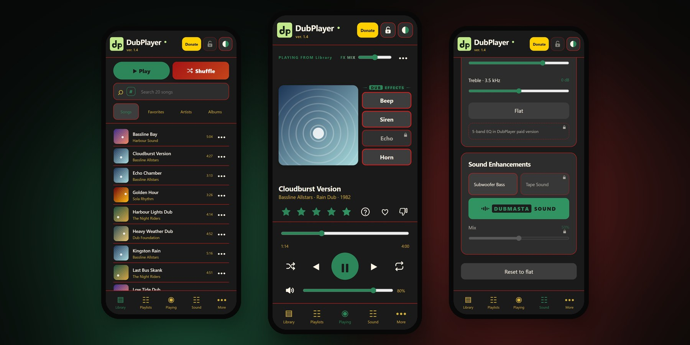
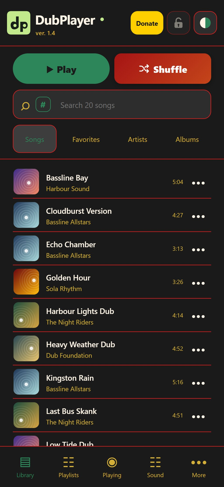
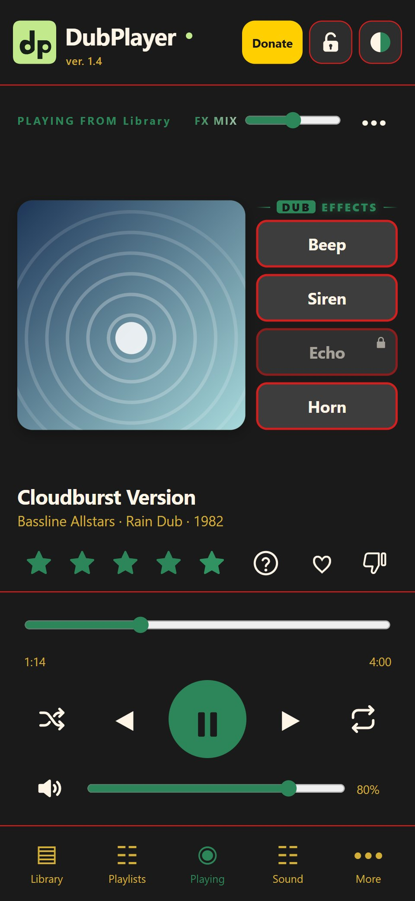
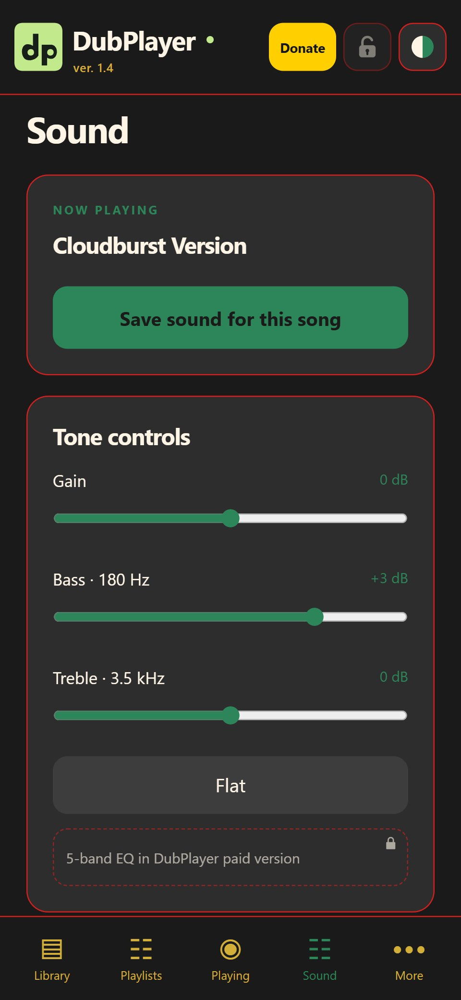
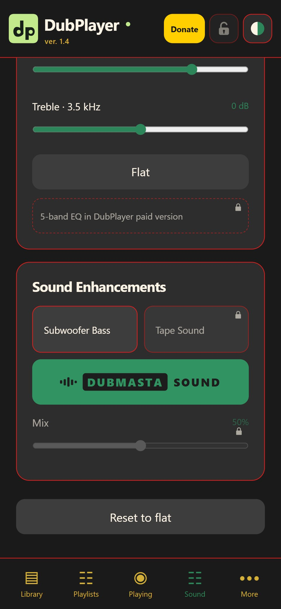
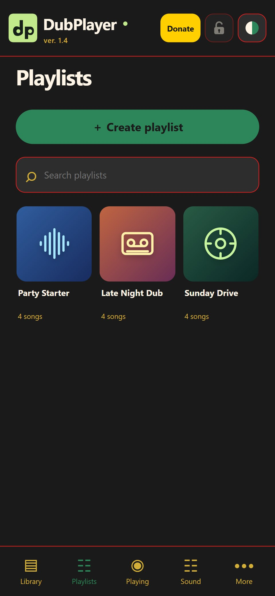
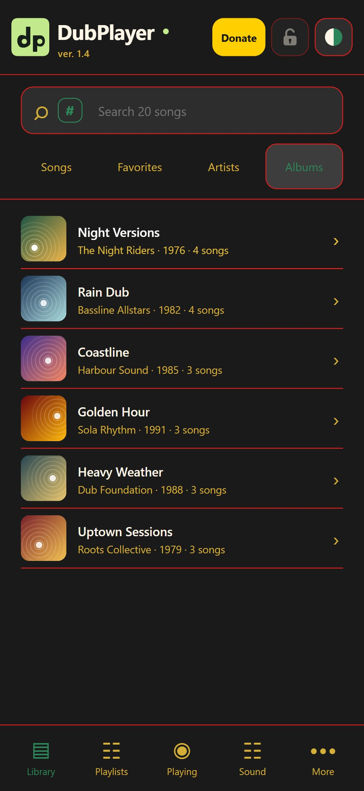
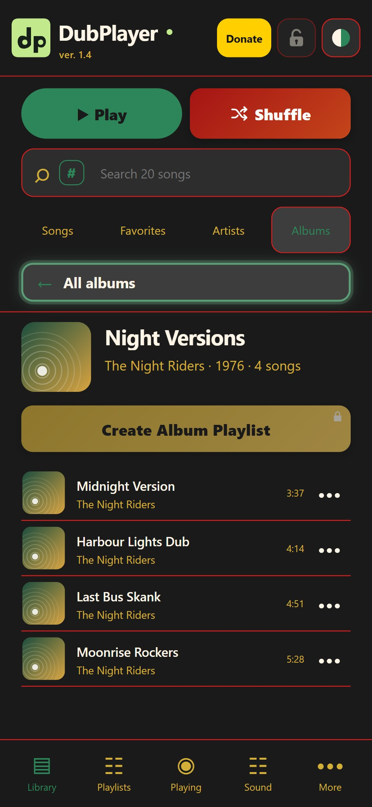
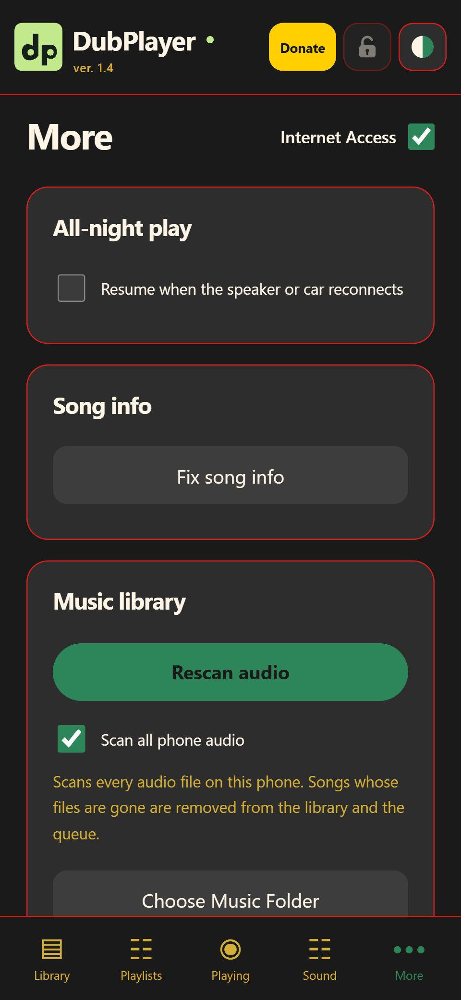

  

<h1 align="center">DubPlayer Free</h1>

  <strong>The music player made for car stereos and Bluetooth speakers.</strong> 
  Your music, your phone, your sound. Free, no account, no ads.

  <a href="https://github.com/Dubmasta/DubPlayer/releases/latest"><strong>⬇ Download DubPlayer Free for Android</strong></a>
  &nbsp;·&nbsp; Android 6.0 or newer &nbsp;·&nbsp;
  <a href="https://www.dubmasta.com/dubplayer/">dubmasta.com/dubplayer</a>

---

## Give your old Android phone a new job

**Got an old Android phone or tablet sitting in a drawer? Turn it into a dedicated Bluetooth music player.**

Load your music onto it, pair it with your car stereo or Bluetooth speaker, and leave it in the car or next to the speaker. DubPlayer turns it into a music box that does one job well:

- 🚗 **Always ready in the car.** Your main phone stays free for calls and maps, and keeps its battery.
- 📴 **No SIM card, no Internet, no account needed.** It plays the music stored on the phone.
- 🔁 **Plays all night.** With the screen off and nothing to keep tapping. If the speaker or car reconnects within 30 minutes, the music picks up where it stopped.
- 🎛️ **Control it from the car.** Play, pause, next and back from the steering wheel, the stereo or the speaker, like a real deck.

That old phone in the drawer becomes your car's own jukebox.

---

## Why DubPlayer

Most music players are made for earbuds and streaming. DubPlayer is made for **the music you own**, played **loud and clean** through a car or a speaker.

### 🎲 Random that keeps your music fresh
Tap **Shuffle** and DubPlayer works through your whole library before it repeats. Songs you heart or rate highly come round more often. Songs you vote down are left out.

### ❤️ Hearts, stars and thumbs-down
Rate songs as you listen. A heart, 1 to 5 stars, or a thumbs-down if you never want to hear it again.

### 🔊 Sound shaped for the car
- **Gain, Bass and Treble** controls, with a one-tap **Flat**.
- **Subwoofer Bass:** a deep lift for the low notes a subwoofer or car woofer plays.
- **Dubmasta Sound:** one tap and DubPlayer makes every song sound its best on big speakers, by itself. Quiet songs come up to sit with today's loud ones, the sound gets fuller and more even, and dull or low-quality files (like 128 kbps MP3s) get their sparkle back. Songs that already sound great are left as they are.
- A built-in **limiter**, so the sound never clips or distorts, even turned up.
- **Save a sound for one song**, and it plays that way every time.

### 📯 Dub sound effects
**Beep**, **Siren** and **Horn** play right over your music, the way a sound system DJ does it. Hold the Beep for a long beep. The **FX MIX** slider sets how loud they play against the song.

### 🚘 Made for Bluetooth cars and speakers
- Play, pause, next and back from the car, the speaker, the notification or the lock screen.
- **Back** restarts the song if it has played more than a few seconds; press again for the song before.
- **Hold Next or Back** on the car or speaker to fast-forward or rewind.
- A **screen lock** button stops stray taps while you drive.

### 📚 Your whole library, organised
- **Songs, Favorites, Artists and Albums**, with a fast search.
- Type **`#mostplayed`** in the search box to see your favourites by play count.
- **Playlists** for every mood, with their own search. Play them in order, shuffled or on loop.
- Opens in seconds, from a few songs to tens of thousands.

### 🏷️ Song info that fills itself in
DubPlayer reads the song details in your files. When a file has none, it uses the file and folder names. With Internet Access on, it quietly completes missing titles, artists, albums and covers for the songs you play. You can also look a song up yourself, or **identify it by sound**.

### 🎨 Three skins
MoreDub, Forest and Bright Contrast.

---

## Screenshots

<table>
  <tr>
    <td align="center"> <b>Library</b> Play, Shuffle and search</td>
    <td align="center"> <b>Playing</b> Dub effects, stars and hearts</td>
    <td align="center"> <b>Sound</b> Gain, Bass, Treble, per-song sound</td>
    <td align="center"> <b>Enhancements</b> Subwoofer Bass, Dubmasta Sound</td>
  </tr>
  <tr>
    <td align="center"> <b>Playlists</b> For every mood</td>
    <td align="center"> <b>Albums</b> Ready to play</td>
    <td align="center"> <b>An album</b> Its songs in order</td>
    <td align="center"> <b>More</b> All-night play, song info, rescan</td>
  </tr>
</table>

The songs, artists and covers in these pictures are made up for the screenshots.

---

## Install in four steps

1. **Download.** On your Android phone or tablet, open the [latest release](https://github.com/Dubmasta/DubPlayer/releases/latest) and tap the **DubPlayer-Free** APK file. Chrome may warn that this type of file can be harmful: tap **Download anyway**. It is the DubPlayer app, made and signed by Dubmasta.
2. **Open the file.** Tap the finished download in the notification, or open the **Files** app, go to **Downloads** and tap the DubPlayer file.
3. **Allow and install.** Android may say your browser is not allowed to install apps. Tap **Settings**, turn on **Allow from this source**, go back and tap **Install**. If Google Play Protect asks, let it scan the app, then install it.
   *Samsung:* if the install is blocked, turn off **Auto Blocker** for a moment (Settings → Security and privacy → Auto Blocker), install, then turn it back on.
4. **Open DubPlayer.** Allow access to your music when asked. DubPlayer finds your songs and is ready to play in seconds.

**Plays:** MP3, FLAC, M4A, AAC, WAV, OGG and Opus.
**Needs:** Android 6.0 or newer. Not available for iPhone, iPad or computers.

---

## Privacy

**Your music stays on your device.** No account, no ads, no tracking.

With **Internet Access** on, DubPlayer looks up missing song information and covers for the songs you play. It uses MusicBrainz, AcoustID and the Cover Art Archive. Turn Internet Access off and DubPlayer never goes online.

A usage report is sent only when you choose to send it. It holds no song, artist, playlist, file or device names.

📄 [Privacy policy and terms of use](https://www.dubmasta.com/dubplayer/privacy/)

---

## Free and paid

**DubPlayer Free has everything you need to play your music.**

The **DubPlayer paid version**, coming later, adds:
- the **Echo** effect and **Tape Sound**;
- a **Mix** slider for each sound enhancement;
- a **5-band EQ** with presets;
- more skins and **album playlists**;
- **saving song information into your music files**;
- and more.

In Free, these show a small lock.

---

## ⚠️ Made for car stereos and speakers

DubPlayer is not designed for headphones. Some sound effects, and the bass and tone settings, can be very loud and may harm your hearing in headphones. If you use headphones, keep the volume low.

---

## Support DubPlayer

DubPlayer Free is free and has no ads. If you enjoy it, you can buy the developer a coffee: ☕ [buymeacoffee.com/dubmasta](https://buymeacoffee.com/dubmasta)

**Questions or problems:** [info@dubmasta.com](mailto:info@dubmasta.com) · or open an [issue](https://github.com/Dubmasta/DubPlayer/issues) here.

---

This repository hosts the DubPlayer Free app for download. The app's source code is not published.
DubPlayer © Dubmasta Digital Creativity. All rights reserved. Free to download and use.
Bundled open-source components are listed in the app under More → About, support &amp; credits.
